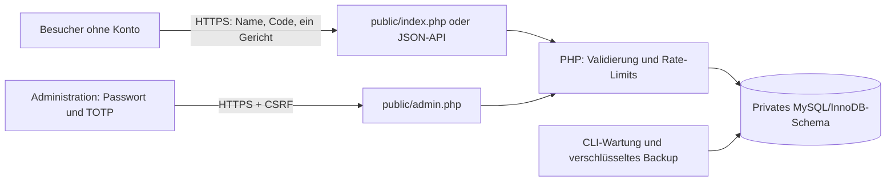

# Architektur und Schnittstellen

## Projektstruktur

public/: einzige Dokumentwurzel, enthält Formular, Admin, Rechtstexte, CSS/JS, Statistik und JSON-Endpunkte. src/: Sicherheits-, Anmelde-, Verwaltungs- und Backuplogik. database/: Neuanlageschema und einmalige Migrationen. tools/: nicht öffentliche CLI-Werkzeuge. tests/: Unit-, Datenbank-, Parallelitäts-, Migrations- und HTTP-Tests. docs/: Konzept, Betrieb und Abnahmen.

## Datenmodell

- residents: Namen und normalisierter Name, Aktivstatus, eindeutiger optionaler Code-HMAC, Code-Sperrstatus, Zeitstempel. Namensindex nicht eindeutig, weil Namensgleichheit real möglich ist.
- registrations: Unique resident_id, Fremdschlüssel mit Kaskade, genau eine gesetzte Gerichtsspalte per CHECK, Status und Zeitstempel.
- app_settings: eine globale Zeile mit Registrierungsschalter. Sperrpunkt für gleichzeitiges Öffnen/Schließen und Speichern.
- admin_auth_state: letzter akzeptierter TOTP-Zeitschritt pro konfiguriertem Admin, schützt vor Wiederverwendung.
- visitor_statistics: Tag und Aufrufe. online_visitors: kurzlebige SitzungshMACs. rate_limits: kurzlebige IP-/Zeitfenster-HMACs.
- admin_audit_log: Aktion, Ergebnis, Administratorkennung, Zeitpunkt.

Die Anwendung ist bewusst für eine Veranstaltung ausgelegt. Für weitere Veranstaltungen getrennte Installation verwenden oder das Modell mit event_id und passenden zusammengesetzten Constraints erweitern.

## HTTP-Schnittstellen

Alle Endpunkte sind für dieselbe Origin ausgelegt. Keine öffentliche Einwohnerabfrage, kein Code in Querystrings. Cookies sind sitzungsgebunden und Antworten werden nicht gespeichert. Kein Cross-Origin-Backend für GitHub Pages ist in dieser Version konfiguriert.

| Endpunkt | Methode und Zweck | Schutz/Antwort |
|---|---|---|
| /index.php bzw. / | GET Formular, POST Anmeldung/Änderung | CSRF-Formularfeld, Name+Code+meal, Rate-Limit, 303 bei gespeichertem Wunsch |
| /api/session.php | GET Sitzungstoken und Öffnungsstatus | Nur csrf und registration_open; keine personenbezogenen Daten |
| /api/registration.php | POST JSON-Anmeldung/Änderung | Sitzungscookie und X-CSRF-Token, application/json, maximal 4 KB |
| /stats.php | GET Aggregate, optional ?view=1 | IP-Zeitfensterlimit, datensparsame Statistik |
| /admin.php | GET Login/Verwaltung, POST Aktionen | Passwort+TOTP, danach Adminsitzung, CSRF und Aktionslimit |
| /legal.php | GET Impressum und Datenschutz | Keine DB-Personendaten |

JSON-Anmeldebody: `{"name":"Max Muster","invitation":"CODE-AUS-EINLADUNG","meal":"eisbein"}`. meal ist ausschließlich schweinekopf oder eisbein. Einladungscodes werden nie in Antworten zurückgegeben. Neue API-Sitzungen benötigen dieselbe Mindestwartezeit von zwei Sekunden wie das Formular.

JSON-Antwort bei Erfolg: `{"message":"Dein Essenswunsch wurde gespeichert."}`. Falsche Name-/Code-Kombinationen: gleichlautende Meldung, 422. Geschlossen: 409. Token fehlt/falsch: 403. Rate-Limit: 429. Falsche Methode: 405. Falscher Inhaltstyp: 415. Ungültiges JSON: 400. Zu großer Body: 413. Interner Fehler: 503 mit neutralem Diensthinweis. Keine CORS-Freigabe.

Adminaktionen: login, logout, import, resident_save, code_rotate, code_revoke, correct, cancel, export, registration_toggle, purge. Export nur als geschützter POST; schützt auch vor unbeabsichtigten Downloads durch Linkvorschauen. CSV neutralisiert mögliche Tabellenformeln. Backups/Restore laufen über CLI, nicht über öffentliche Upload-/Download-Endpunkte.
